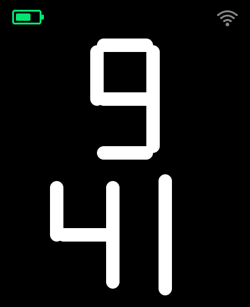
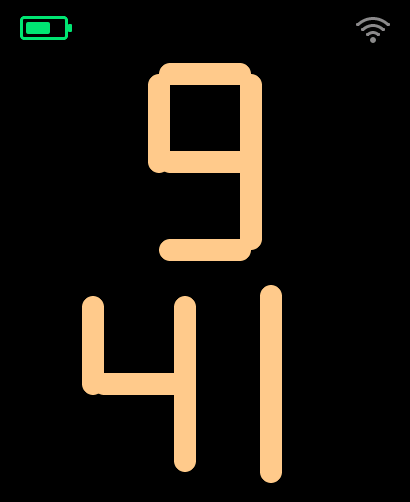
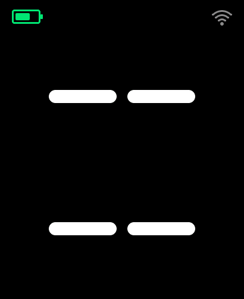

# MosuTime

A watch for someone who needs very few things.

MosuTime is an ESP32-S3 smartwatch built for an elderly man with dementia who
has sight in one eye. It shows **one thing**: the time, as large as the screen
allows. No menus, no notifications, no steps, no watch faces.

The watch face is deliberately boring:

* the hour on one line, the minutes on another, 12-hour format, no leading
  zero, no colon;
* a small battery icon in one corner and a small Wi-Fi icon in the other,
  inset far enough to clear the AMOLED's rounded corners;
* **white numerals in the morning, warm amber numerals in the evening** - he
  knows whether it is AM or PM from the colour, without reading anything;
* otherwise the screen is black and off.

A double tap on the glass says the time out loud in Romanian, for example
*"Este ora două și treizeci de minute. Marți."* The voice clips live on the SD
card, not in flash.

**Download:** [MosuTime v1.1.0](https://github.com/lgstoian/MosuTime/releases/tag/v1.1.0)
has the merged firmware image, the self-contained Windows manager
(`MosuTimeManager.exe`), the SD card zip and checksums. Flashing and first-run
steps are in [`docs/release.md`](docs/release.md).

| Day (AM) | Evening (PM) | Time not set |
| --- | --- | --- |
|  |  |  |

These three pictures come from the firmware itself running in the
[ESP32 emulator](tools/emu/README.md): the actual LVGL frame, sent over QSPI,
was reconstructed from the emulator's bus log. The desktop simulator
(`sim/`) draws the same face with the same digit geometry and layout constants
for a quick preview without any emulator.

## Design rules

1. **One decision per glance.** Huge numerals, 12-hour time, nothing that
   competes for attention.
2. **Colour carries AM/PM.** No AM/PM text, no 24-hour time.
3. **Off by default.** The AMOLED and the LVGL task are stopped unless the
   wearer raises his wrist or touches the screen.
4. **Never surprise him.** Brightness is fixed by the config file, the screen
   always looks the same, and a failed time sync never blanks the clock - it
   keeps running on the RTC.
5. **Speak only when asked.** The announcement is a double tap, and the exact
   hour is spoken without any "fix" wording: *"Este ora două."*

## Hardware

* [Waveshare ESP32-S3-Touch-AMOLED-2.06](https://docs.waveshare.com/ESP32-S3-Touch-AMOLED-2.06)
  - ESP32-S3 with 8 MB PSRAM, 32 MB flash
  - 410 x 502 CO5300 AMOLED, QSPI
  - FT3168 touch
  - AXP2101 PMU, PCF85063 RTC, QMI8658 IMU, ES8311 codec, microSD
* ESP-IDF **5.5.5**, LVGL **9.6.0**
* A FAT32 microSD card (the voice clips and `mosu.cfg` live there)

Board-specific notes: the QMI8658C has SA0 high and answers at **0x6B**, and
the RTC is a **PCF85063A** whose time registers start at 0x04. The TF socket
also carries an SPI chip select on DAT3/GPIO17, which the firmware drives high
before the 1-bit SDMMC mount. See [`docs/findings.md`](docs/findings.md).

The firmware does not use the Waveshare BSP. `components/mosu_board` talks to
the panel, touch controller, PMU, RTC, IMU and codec directly, so a port to
another board replaces one component and nothing else.

## Build

```sh
# once, in an ESP-IDF 5.5.x environment
idf.py set-target esp32s3
idf.py build
idf.py -p COM11 flash monitor
```

The board's only reachable USB port is the ESP32-S3 native USB, so the
firmware uses USB Serial/JTAG as the **primary** console. UART0 is available
only on the reserved GPIO43/44 pads. Use the COM port Windows assigns to the
watch; this machine enumerates it as COM11.

On Windows, run `export.bat` from the ESP-IDF installation first. If another
Xtensa toolchain is earlier in `PATH` (for example the one installed by
`espup`/rustup), the project checks the compiler version at configure time.
`tools/build.ps1` puts the IDF-managed toolchain first and handles the normal
stderr output from the IDF environment.

```powershell
.\tools\build.ps1 -Port COM11 -Flash
```

The partition table is 32 MB with two OTA application slots and a data
partition for NVS. The default configuration enables automatic light sleep,
DFS, PSRAM, the certificate bundle for optional HTTPS endpoints, and 1000 Hz
FreeRTOS ticks. Automatic light sleep is held off while a USB host is
connected so the native-USB console stays alive; it resumes when the cable is
unplugged.

## SD card

```
/
├── mosu.cfg                 configuration, see sd_card/mosu.cfg
└── voice/
    ├── h_1.wav ... h_12.wav hour phrases
    ├── m_1.wav ... m_59.wav minute phrases
    └── d_0.wav ... d_6.wav  weekdays (0 = Monday)
```

The card is optional at boot: if it is missing or unreadable the watch uses the
last good configuration cached in NVS, and stays silent. The watch can format
the card itself and receive the files over the USB console, so no card reader
or third-party formatter is needed:

```sh
# Format FAT32 (MBR, 32 KB clusters), then push mosu.cfg and the 78 clips.
python tools/push_sd.py COM11 --format --ssid camera --pass 'secret'
```

Without `--format` the tool only uploads. It uses the console's ACK-paced
`receive <path> <size> /crc` protocol, so every clip is written in order and
verified with a CRC-32 before the next one starts; the whole 5.4 MB set takes
about 20 seconds over USB Serial/JTAG. A card formatted on the PC
also works, but the FAT table must be complete: some Windows formatters write a
FAT32 volume that Windows accepts and FatFs rejects (`failed to mount card
(13)`, `FR_NO_FILESYSTEM`). `sd format yes` or `--format` is the reliable path.

### Windows app

`tools/mosu-gui.cmd` (or `python tools/mosu_gui.py`) opens a small manager for
the watch: a dashboard with firmware version, MAC, clock, battery and SD state;
a console tab; a **Settings** tab that edits every key in `sd_card/mosu.cfg`
with the firmware's own ranges and pushes it to the card; build and flash
through `tools/build.ps1`; SD format and file push; and a shutdown button. It
needs `pyserial` (`python -m pip install pyserial`) and the same ESP-IDF 5.5.x
installation as the build script.

A self-contained **MosuTimeManager.exe** (no Python) and the merged firmware
image are attached to every GitHub release; see
[`docs/release.md`](docs/release.md). Build one with
`.\tools\release.ps1` after tagging.

Edit the Wi-Fi network and brightness in `sd_card/mosu.cfg` (or pass `--ssid`
and `--pass` to the push tool), generate the voice with the script below, then
push both with `tools/push_sd.py` or the app's SD tab.

### Configuration

Everything is in `mosu.cfg`: brightness, how long the screen stays on, wrist
raise sensitivity, pixel-shift interval, colours, battery thresholds, the Wi-Fi
list, the timezone, NTP servers, sync interval and the announcement volume.
The annotated template in [`sd_card/mosu.cfg`](sd_card/mosu.cfg) is the
reference.

```ini
[display]
brightness = 55          # 1..100, applied as the panel's own brightness
screen_on_ms = 11250

[clock]
auto_timezone = true
timezone = Europe/Bucharest
sync_hours = 12          # interval in hours, 1..168
sync_per_day = 0         # 1..24 overrides sync_hours; 0 = use sync_hours

[announce]
volume = 85
```

Invalid lines are reported on the console but never abort the boot: the watch
keeps the previous value for that key.

### Voice

The clips are generated by running the free Romanian `ro_RO-mihai-medium` voice
through `onnxruntime`, with the pronunciation coming from a small MIT lexicon
in this repository:

```sh
pip install onnxruntime
python tools/gen_voice.py --out sd_card/voice
```

The script downloads the voice into `tools/piper-models/`, renders all 78
clips (12 hours, 59 minutes, 7 weekdays), trims silence and normalises each
clip to -3 dBFS. Nothing is embedded in the firmware, so the voice and the
wording can be replaced by copying new files onto the card. A second script,
`tools/check_voice.py`, verifies the whole set (format, levels and a duration
that matches the words), and `--preview` writes one combined sentence for a
family review.

Romanian grammar is handled in `tools/gen_voice.py`: *un minut*, *două
minute*, *douăzeci de minute*, *douăzeci și una de minute*. The full phrase
list and the replacement procedure are in [`docs/voice.md`](docs/voice.md).

## Behaviour

| Event | What happens |
| --- | --- |
| Wrist raise | screen on, full repaint, off again after `screen_on_ms` |
| Touch | screen on; the touch interrupt also wakes the CPU from light sleep |
| Double tap | a short border flash, then the time and weekday are spoken |
| Exact hour | only the hour phrase is played: *"Este ora două."* |
| Wi-Fi sync | at boot and every `sync_hours` or `sync_per_day`, with 5/15/30 minute retries after a failure; the radio is switched off immediately after |
| Wi-Fi lost | the clock keeps running from the RTC; the icon turns red; no panic; a presence scan notices when the network returns |
| No time yet | `--` is shown until the RTC, manual time or SNTP provides a date |

The Wi-Fi icon is grey before the first successful sync, green after a
successful one, and red (with a slash) when the last attempt failed.

### Power

While the screen is off:

* the panel is put into **sleep-in** (`0x10`), not just display-off, so its
  bias draws microamps; waking does sleep-out, draws the first frame while the
  panel is still dark, then switches the display on;
* LVGL's tick timer is stopped, so nothing renders and the touch panel is not
  polled;
* the CPU enters automatic light sleep between accelerometer samples;
* the IMU is sampled at `motion_poll_hz` (default 8 Hz) and the touch
  controller's interrupt line is a GPIO wake source;
* the radio is off unless a sync is due. The presence scan follows a learned
  per-hour score: 15 minutes when the watch is normally home at that hour, up
  to 4 hours when it never is.
* the screen-on window and the wrist threshold adapt to the wearer's actual
  wake rate, within bounded steps (at most +14 deg, at least an 8 s window).

`stats` on the console reports uptime, screen-on seconds, wakes and the
estimated average current since the last `stats reset`. The counters live in
RTC no-init memory, so opening the USB console (which resets the CPU) does not
lose a measurement that started on battery.

When the screen is on, a `NO_LIGHT_SLEEP` power lock is held so the QSPI
transfers are never interrupted. The CPU is capped at 160 MHz for the same
reason - this is a clock, not a game console.

Expect days of runtime from the shipped cell. The exact figure depends on the
cell, the touch controller, the wrist-raise rate and the sync interval; the
learned policy is what keeps a fidgety day from costing the whole cell.
[`docs/power.md`](docs/power.md) has the measurement procedure and the table
to fill before promising anything to the wearer.

## Emulator

There is no need for the watch to be on the desk to see what it does. The
firmware runs in [esp-emu](https://github.com/espressif/esp-emulator) with a
virtual CO5300 panel and `regfile` models of the AXP2101, PCF85063, QMI8658,
FT3168 and ES8311. The panel part records every QSPI transfer, and
`tools/emu/reconstruct.py` turns that stream back into a 410 x 502 PNG - the
pictures at the top of this file are made that way.

```sh
tools/emu/capture.sh
```

The script boots the firmware four times (AM, PM with `settime`, unknown time,
low battery) and checks that each run reaches "watch face ready". See
[`tools/emu/README.md`](tools/emu/README.md) for the one-time setup and for
what the emulator does and does not model. It also shows how to drive the
console with `--inject-on`/`--inject`, which is how the phrase builder was
checked (`h_9.wav`, `m_41.wav`, `d_1.wav` at 09:41 on a Tuesday).

## Desktop preview and tests

The pure C core (time formatting, phrase building, battery curve, tap and
wrist detectors, seven-segment renderer) is shared by the firmware, the host
tests and the simulator.

```sh
# host tests (450 checks)
cmake -S test/host -B test/host/build
cmake --build test/host/build
./test/host/build/mosu_tests

# watch face preview -> sim/out/*.bmp
cmake -S sim -B sim/build
cmake --build sim/build
mkdir -p sim/out && ./sim/build/mosu_sim sim/out
```

On Windows use `-G "MinGW Makefiles"`. The simulator writes four scenes: AM,
PM, low battery with a failed sync, and the unknown-time state.

## Layout

```
components/
  mosu_core/    pure C: no ESP-IDF, shared with tests and simulator
  mosu_session/ pure C: screen/tap/battery state machine
  mosu_policy/  pure C: timezone offsets, geo parsing, sync backoff
  mosu_config/  INI parser + NVS last-good cache
  mosu_board/   the only board-specific code
  mosu_time/    RTC, SNTP, IANA -> POSIX timezone table
  mosu_net/     Wi-Fi, geolocation, SNTP, radio cycling
  mosu_audio/   announcement queue, clip chaining
  mosu_ui/      the watch face, one custom-drawn LVGL screen
  mosu_diag/    UART console for maintenance
main/           power state machine
sim/            desktop preview
test/host/      host tests
tools/          voice generation, build helper, power model, contact sheet
tools/emu/      esp-emu board, panel part, screenshot reconstruction
```

The clock numerals are drawn, not shaped from a font: each digit is a handful
of thick lines (`mosu_digits.c`). The same code draws into LVGL on the watch
and into a BMP on a PC, so the family can approve the face on a laptop before
anything is flashed.

`docs/architecture.md` explains the data flow and what a port to another board
has to provide. The rest of the documentation:

- [`docs/bringup.md`](docs/bringup.md) - first-hardware checklist
- [`docs/power.md`](docs/power.md) - power states, estimates and measurement
- [`docs/voice.md`](docs/voice.md) - phrases, grammar and regeneration
- [`docs/maintenance.md`](docs/maintenance.md) - config, SD card, updates
- [`docs/family-ro.md`](docs/family-ro.md) - the one-page guide for the family
- [`docs/accessibility/README.md`](docs/accessibility/README.md) - print-size
  and contrast checks
- [`AGENTS.md`](AGENTS.md) and [`BREADCRUMBS.md`](BREADCRUMBS.md) - orientation
  and the "where is it" map for contributors

## Console

The USB/UART console is for maintenance, not for the wearer:

```
help status time sync say settime bright N vol N tap reboot
i2c pmu rtc imu touch motion [s] pm heap tasks display config mem
audit [wifi|imu|touch|audio|panel on|off] | touch rate <ms> <s>
pmu rail <name> on|off | wifi <ssid> <password> | wifi scan | wifi presence
test screen [colors|grid|corners|off] | test touch | test audio
scene clock|blank
screenshot [path] | sd remount | sd verbose | sd dump
sd format yes | receive <path> <size> [/crc] | md <path> | ls [path]
rm <path> | rx bench <bytes> | power screen on|off | power panel on|off
power wifi | power idle | poweroff | nvs erase
```

`bright` and `vol` change the value at runtime; edit `mosu.cfg` to make it
permanent. `screenshot /sdcard/shot.bmp` captures the live LVGL scene as a
24-bit BMP on the card, which is how a real watch can be photographed without a
camera; `display` prints the panel and buffer configuration.

## License

MIT, copyright 2026 Stoian Alexandru. See [LICENSE](LICENSE) and
[THIRD_PARTY_NOTICES.md](THIRD_PARTY_NOTICES.md).
