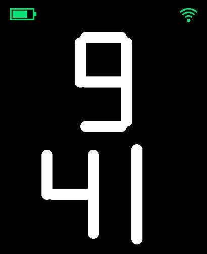
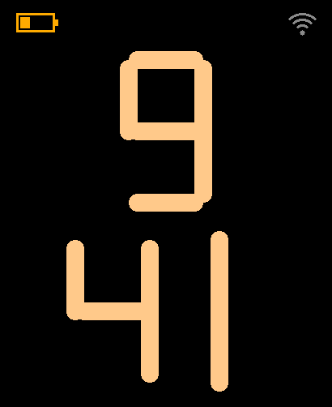

# MosuTime

A watch for someone who needs very few things.

MosuTime is an ESP32-S3 smartwatch built for an elderly man with dementia who
has sight in one eye. It shows **one thing**: the time, as large as the screen
allows. No menus, no notifications, no steps, no watch faces.

The watch face is deliberately boring:

* the hour on one line, the minutes on another, 12-hour format, no leading
  zero, no colon;
* a small battery icon in one corner and a small Wi-Fi icon in the other;
* **white numerals in the morning, warm amber numerals in the evening** - he
  knows whether it is AM or PM from the colour, without reading anything;
* otherwise the screen is black and off.

A double tap on the glass says the time out loud in Romanian, for example
*"Este ora două și treizeci de minute. Marți."* The voice clips live on the SD
card, not in flash.

| Day (AM) | Evening (PM) |
| --- | --- |
|  |  |

The pictures above are produced by the desktop simulator, using the same digit
geometry and layout constants as the firmware.

## Design rules

1. **One decision per glance.** Huge numerals, 12-hour time, nothing that
   competes for attention.
2. **Colour carries AM/PM.** No AM/PM text, no 24-hour time.
3. **Off by default.** The AMOLED and the LVGL task are stopped unless the
   wearer raises his wrist or touches the screen.
4. **Never surprise him.** Brightness is fixed by the config file, the screen
   always looks the same, and a failed time sync never blanks the clock - it
   keeps running on the RTC.
5. **Speak only when asked.** The announcement is a double tap, and the exact
   hour is spoken without any "fix" wording: *"Este ora două."*

## Hardware

* [Waveshare ESP32-S3-Touch-AMOLED-2.06](https://docs.waveshare.com/ESP32-S3-Touch-AMOLED-2.06)
  - ESP32-S3 with 8 MB PSRAM, 32 MB flash
  - 410 x 502 CO5300 AMOLED, QSPI
  - FT3168 touch
  - AXP2101 PMU, PCF85063 RTC, QMI8658 IMU, ES8311 codec, microSD
* ESP-IDF **5.5.5**, LVGL **9.6.0**
* A FAT32 microSD card (the voice clips and `mosu.cfg` live there)

The firmware does not use the Waveshare BSP. `components/mosu_board` talks to
the panel, touch controller, PMU, RTC, IMU and codec directly, so a port to
another board replaces one component and nothing else.

## Build

```sh
# once, in an ESP-IDF 5.5.x environment
idf.py set-target esp32s3
idf.py build
idf.py -p COM5 flash monitor
```

On Windows, run `export.bat` from the ESP-IDF installation first. If another
Xtensa toolchain is earlier in `PATH`, put the one matching your IDF version
first; the project checks the compiler version at configure time.

`tools/build.ps1` wraps this for a Windows machine:

```powershell
.\tools\build.ps1 -Port COM5 -Flash
```

The partition table is 32 MB with two OTA application slots and a data
partition for NVS. The default configuration enables automatic light sleep,
DFS, PSRAM, the certificate bundle for HTTPS, and 1000 Hz FreeRTOS ticks.

## SD card

```
/
├── mosu.cfg                 configuration, see sd_card/mosu.cfg
└── voice/
    ├── h_1.wav ... h_12.wav hour phrases
    ├── m_1.wav ... m_59.wav minute phrases
    └── d_0.wav ... d_6.wav  weekdays (0 = Monday)
```

The card is optional at boot: if it is missing or unreadable the watch uses the
last good configuration cached in NVS, and stays silent. Format the card as
FAT32 with 16 KB or 32 KB clusters (any normal card works).

Copy `sd_card/mosu.cfg` to the card, edit the Wi-Fi network and brightness,
and generate the voice with the script below.

### Configuration

Everything is in `mosu.cfg`: brightness, how long the screen stays on, wrist
raise sensitivity, pixel-shift interval, colours, battery thresholds, the Wi-Fi
list, the timezone, NTP servers, sync interval and the announcement volume.
The annotated template in [`sd_card/mosu.cfg`](sd_card/mosu.cfg) is the
reference.

```ini
[display]
brightness = 55          # 1..100, applied as the panel's own brightness
screen_on_ms = 15000

[clock]
auto_timezone = true
timezone = Europe/Bucharest

[announce]
volume = 85
```

Invalid lines are reported on the console but never abort the boot: the watch
keeps the previous value for that key.

### Voice

The clips are generated with [Piper](https://github.com/rhasspy/piper) and the
free Romanian `ro_RO-mihai-medium` voice:

```sh
pip install piper-tts
python tools/gen_voice.py --out sd_card/voice
```

The script downloads the voice into `tools/piper-models/`, renders all 78
clips (12 hours, 59 minutes, 7 weekdays), and checks that each file is mono
16-bit WAV. Nothing is embedded in the firmware, so the voice and the wording
can be replaced by copying new files onto the card.

Romanian grammar is handled in `tools/gen_voice.py`: *un minut*, *două
minute*, *douăzeci de minute*, *douăzeci și una de minute*.

## Behaviour

| Event | What happens |
| --- | --- |
| Wrist raise | screen on, full repaint, off again after `screen_on_ms` |
| Touch | screen on; the touch interrupt also wakes the CPU from light sleep |
| Double tap | a short border flash, then the time and weekday are spoken |
| Exact hour | only the hour phrase is played: *"Este ora două."* |
| Wi-Fi sync | at boot and every `sync_hours`; the radio is switched off immediately after |
| No time yet | `--` is shown until the RTC, manual time or SNTP provides a date |

The Wi-Fi icon is grey before the first successful sync, green after a
successful one, and red (with a slash) when the last attempt failed.

### Power

While the screen is off:

* the panel is switched off with its own command and the brightness is zeroed;
* LVGL's tick timer is stopped, so nothing renders and the touch panel is not
  polled;
* the CPU enters automatic light sleep between accelerometer samples;
* the IMU is sampled at `motion_poll_hz` (default 8 Hz) and the touch
  controller's interrupt line is a GPIO wake source;
* the radio is off unless a sync is due.

When the screen is on, a `NO_LIGHT_SLEEP` power lock is held so the QSPI
transfers are never interrupted. The CPU is capped at 160 MHz for the same
reason - this is a clock, not a game console.

Expect days of runtime from the shipped cell, and weeks if the watch is rarely
looked at. The exact figure depends on the cell, the number of wrist raises and
the sync interval; measure it with `idf.py monitor` and the `status` command
before promising anything to the wearer.

## Desktop preview and tests

The pure C core (time formatting, phrase building, battery curve, tap and
wrist detectors, seven-segment renderer) is shared by the firmware, the host
tests and the simulator.

```sh
# host tests (184 checks)
cmake -S test/host -B test/host/build
cmake --build test/host/build
./test/host/build/mosu_tests

# watch face preview -> sim/out/*.bmp
cmake -S sim -B sim/build
cmake --build sim/build
mkdir -p sim/out && ./sim/build/mosu_sim sim/out
```

On Windows use `-G "MinGW Makefiles"`. The simulator writes four scenes: AM,
PM, low battery with a failed sync, and the unknown-time state.

## Layout

```
components/
  mosu_core/    pure C: no ESP-IDF, shared with tests and simulator
  mosu_config/  INI parser + NVS last-good cache
  mosu_board/   the only board-specific code
  mosu_time/    RTC, SNTP, IANA -> POSIX timezone table
  mosu_net/     Wi-Fi, geolocation, SNTP, radio cycling
  mosu_audio/   announcement queue, clip chaining
  mosu_ui/      the watch face, one custom-drawn LVGL screen
  mosu_diag/    UART console for maintenance
main/           power state machine
sim/            desktop preview
test/host/      host tests
tools/          voice generation, build helper
```

The clock numerals are drawn, not shaped from a font: each digit is a handful
of thick lines (`mosu_digits.c`). The same code draws into LVGL on the watch
and into a BMP on a PC, so the family can approve the face on a laptop before
anything is flashed.

`docs/architecture.md` explains the data flow and what a port to another board
has to provide.

## Console

The USB/UART console is for maintenance, not for the wearer:

```
help status time sync say bright N vol N tap reboot
```

`bright` and `vol` change the value at runtime; edit `mosu.cfg` to make it
permanent.

## License

MIT, copyright 2026 Stoian Alexandru. See [LICENSE](LICENSE) and
[THIRD_PARTY_NOTICES.md](THIRD_PARTY_NOTICES.md).
